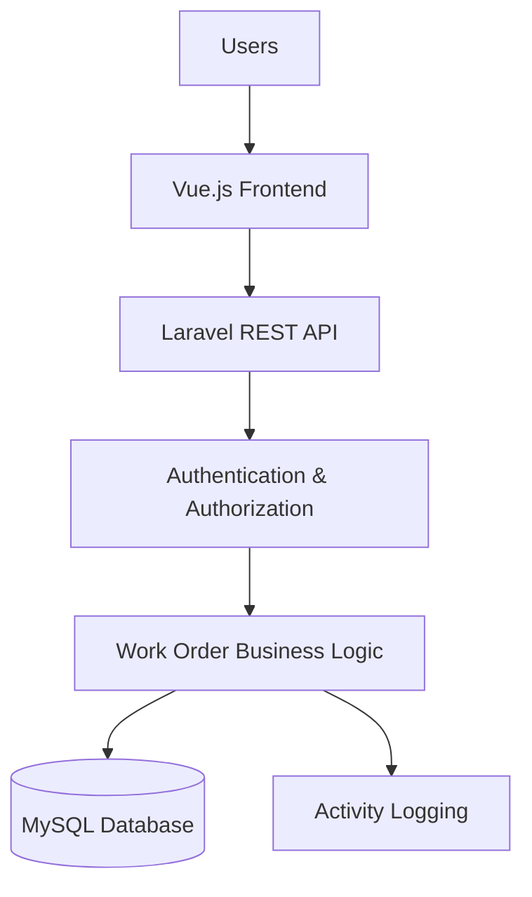

# 🛠️ WOMS — Work Order Management System

### Full-Stack Maintenance Management Application 


**Laravel · Vue.js · RESTful APIs · RBAC · Workflow Management**

---

## 📖 Overview

**WOMS (Work Order Management System)** is a full-stack web application designed to manage internal maintenance requests and work orders.

The project simulates a business environment where different users are responsible for creating, reviewing, assigning, and completing maintenance tasks.

It demonstrates how Laravel and Vue.js can be combined to build an API-driven application with role-based access control, structured workflows, and activity tracking.

The project focuses on backend engineering concepts such as authorization, workflow state management, database relationships, and maintaining a clear separation between frontend and backend responsibilities.

---

## 🚀 Key Features

### 🔐 Authentication & Role-Based Access Control

WOMS uses Laravel Sanctum for token-based authentication and implements role-based access control to manage user permissions.

The system includes three main roles:

| Role | Responsibilities |
|---|---|
| Admin | System administration and user management |
| Manager | Reviewing, approving, rejecting, and managing work orders |
| Operator | Viewing and managing assigned maintenance tasks |

Authorization is enforced through backend middleware and permission checks.

The application also demonstrates a database-driven approach to managing access rights across system modules and actions.

### 🔧 Work Order Management

The system supports:

- Creating maintenance work orders.
- Editing and managing work order information.
- Assigning work orders to users.
- Tracking work order status.
- Reviewing and approving maintenance requests.
- Managing work orders based on user roles.

### 🔄 Workflow Management

Work orders follow a defined lifecycle:

```text
Pending → Approved → In Progress → Completed
              ↘ Rejected
```

The workflow provides a structured approach to tracking maintenance requests from submission to completion or rejection.

Status changes are handled through backend operations and authorization rules.

### 📊 Dashboard & Statistics

The application provides dashboard information to help users monitor maintenance operations.

Features include:

- Work order statistics.
- Status-based summaries.
- Dashboard charts.
- Recent activity information.

### 📜 Activity & Audit Logging

WOMS includes activity logging to track important operations and changes within the system.

The logging functionality helps provide visibility into work order activities and administrative actions.

### 💻 Responsive Frontend

The frontend is developed using Vue.js 3 and Tailwind CSS.

It provides interactive pages for managing work orders, reviewing dashboard information, and performing role-specific operations.

---

## 🏗️ System Architecture

WOMS separates its frontend and backend into two application components.

**Backend — Laravel 12**

Responsible for authentication, authorization, business logic, database operations, and RESTful API endpoints.

**Frontend — Vue.js 3**

Responsible for rendering the user interface, managing client-side interactions, and communicating with the backend API.

**Database — MySQL**

Stores application data, including users, work orders, and activity records.

### High-Level Architecture



---

## ⚙️ Backend Engineering

The Laravel backend handles the application's core functionality.

### RESTful API Development

The backend exposes API endpoints for:

- Authentication.
- Dashboard statistics.
- Work order management.
- Work order assignment.
- Status updates.
- Activity logs.

### Authentication & Authorization

Laravel Sanctum provides token-based authentication.

Custom permission checks and middleware control access to protected operations based on user roles and permissions.

### Business Logic & Workflow

The backend manages work order operations and status changes while applying the application's business rules.

### Database & Eloquent ORM

Eloquent models and relationships are used to manage the application's relational data.

### Validation & API Responses

Laravel validation and structured API responses support communication between the backend and Vue.js frontend.

---

## 🛠️ Technology Stack

| Category | Technologies |
|---|---|
| Backend | PHP 8.2, Laravel 12 |
| Frontend | Vue.js 3, Composition API |
| Database | MySQL |
| Authentication | Laravel Sanctum |
| Authorization | RBAC, Middleware |
| State Management | Pinia |
| Styling | Tailwind CSS |
| Build Tool | Vite |
| API | RESTful APIs |

---

## 📂 Project Structure

The project separates backend and frontend development into dedicated directories.

```text
woms-assessment/
├── backend/
│   ├── app/
│   ├── database/
│   ├── routes/
│   └── ...
│
├── frontend/
│   ├── src/
│   ├── public/
│   └── ...
│
└── README.md
```

---

## ⚙️ Installation Guide

### Prerequisites

Make sure the following tools are installed:

- PHP 8.2 or compatible version.
- Composer.
- Node.js and npm.
- MySQL.
- Git.

### 1. Clone the Repository

```bash
git clone https://github.com/abood3omar/woms-assessment.git
cd woms-assessment
```

### 2. Backend Setup

Navigate to the backend directory:

```bash
cd backend
```

Install PHP dependencies:

```bash
composer install
```

Create the environment file:

```bash
cp .env.example .env
```

Create a MySQL database named `woms_db` and configure the database connection in `.env`:

```env
DB_CONNECTION=mysql
DB_HOST=127.0.0.1
DB_PORT=3306
DB_DATABASE=woms_db
DB_USERNAME=root
DB_PASSWORD=
```

Update the credentials according to your local MySQL configuration.

Generate the application key:

```bash
php artisan key:generate
```

Run database migrations and seeders:

```bash
php artisan migrate --seed
```

Start the Laravel development server:

```bash
php artisan serve
```

The backend should be accessible at:

`http://127.0.0.1:8000`

### 3. Frontend Setup

Open another terminal from the repository root and navigate to the frontend directory:

```bash
cd frontend
```

Install dependencies:

```bash
npm install
```

Start the development server:

```bash
npm run dev
```

The frontend should be accessible at:

`http://localhost:5173`

Make sure the frontend API configuration points to the correct Laravel backend URL.

---

## 🔑 Demo Accounts

The project includes seeded accounts for local testing.

| Role | Email | Password |
|---|---|---|
| Admin | admin@woms.com | password |
| Manager | manager@woms.com | password |
| Operator | operator@woms.com | password |

> **Important:** These credentials are intended for local development and demonstration only. They must not be used in a production environment.

---

## 🧠 Engineering Concepts Demonstrated

WOMS demonstrates several practical software engineering concepts:

- RESTful API development with Laravel.
- Frontend/backend separation.
- Token-based authentication.
- Role-based authorization.
- Workflow and status management.
- Relational database design.
- Activity logging.
- Reusable application components.
- Client-side state management using Vue.js and Pinia.

---

## 🔮 Future Improvements

Potential improvements include:

- Real-time notifications for assignments and status changes.
- A dedicated technician workspace.
- Email notifications.
- Advanced reporting and analytics.
- Improved workflow transition validation.
- Additional automated testing.
- Performance and caching improvements.

---

## 👨‍💻 Developer

**Abdalrhman Hamed**  
Software Engineer | Backend & Full-Stack Development

**GitHub:** [github.com/abood3omar](https://github.com/abood3omar)

**LinkedIn:** [Abdalrhman Hamed](https://www.linkedin.com/in/abdalrhman-hamed-5b929725b/)

---

*WOMS — A practical full-stack project focused on backend architecture, authorization, and structured business workflows.*
